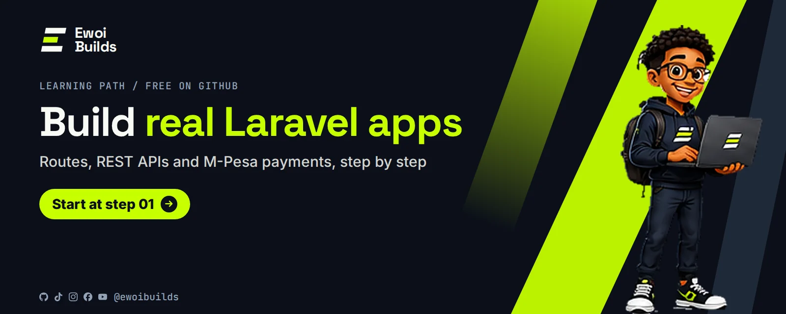

<!-- ewoi:top -->
<p align="center"></p>

<p align="center">
  <a href="step-01-your-first-laravel-route/"><b>Start at step 01 &rarr;</b></a> &nbsp;&middot;&nbsp;
  <a href="https://github.com/ewoibuilds"><b>All free repos</b></a> &nbsp;&middot;&nbsp;
  <a href="https://www.youtube.com/@ewoibuilds"><b>Watch the lessons</b></a>
</p>

<p align="center">
  
  
  
</p>
<!-- /ewoi:top -->

# Practical software development

**Learn. Build. Ship.** The sample code for the Ewoi Builds "Practical software development" path: build pages, APIs and M-Pesa payments with Laravel 13, one working step at a time.

## Start here

Do the lessons in this order. Each step folder holds the files that lesson creates or changes, so you can compare your work or catch up.

| Step | Folder | Lesson |
|---|---|---|
| 01 | [`step-01-your-first-laravel-route`](step-01-your-first-laravel-route) | [Your first Laravel route](https://ewoibuilds.com/lessons/your-first-laravel-route) |
| 02 | [`step-02-fix-the-broken-route`](step-02-fix-the-broken-route) | [Exercise: fix the broken route](https://ewoibuilds.com/exercises/fix-the-broken-route) |
| 03 | [`step-03-build-a-rest-api`](step-03-build-a-rest-api) | [Build a REST API](https://ewoibuilds.com/lessons/build-a-rest-api) |
| 04 | [`step-04-hash-passwords-properly`](step-04-hash-passwords-properly) | [Hash passwords properly](https://ewoibuilds.com/lessons/hash-passwords-properly) |
| 05 | [`step-05-mpesa-stk-push`](step-05-mpesa-stk-push) | [Accept M-Pesa payments in Laravel](https://ewoibuilds.com/lessons/mpesa-stk-push-laravel) |

Then build the path's projects: [task-tracker-laravel](https://github.com/ewoibuilds/task-tracker-laravel) and [mpesa-checkout-api](https://github.com/ewoibuilds/mpesa-checkout-api).

## What you need

- A laptop or desktop and a stable internet connection
- Operating system: Windows 10 or 11, macOS or Linux
- Prerequisites: the Developer foundations path, or the same skills (terminal, Git, how the web works)
- Tools (search for each on its official site; download only from the official site and check the address):
  - PHP 8.3 or newer: search for "Laravel installation php.new" (Laravel's official installer sets up PHP and Composer together)
  - Composer 2: search for "Composer official download"
  - Git: search for "Git official download"
  - A code editor, for example Visual Studio Code: search for "Visual Studio Code official download"
  - For step 05 only: a free Safaricom Daraja developer account (search for "Safaricom Daraja developer portal")

These steps use **Laravel 13**. Check yours with `php artisan --version` inside your app.

## Git setup (once)

1. Set your identity: `git config --global user.name "Your Name"` and
   `git config --global user.email "you@example.com"` (the email you use on GitHub).
2. To push your own copy, set up an SSH key (`ssh-keygen -t ed25519 -C "you@example.com"`, add the `.pub` key on GitHub under Settings, SSH and GPG keys, test with `ssh -T git@github.com`) or a fine-grained personal access token used as your password over HTTPS. Keep the private key and the token to yourself.
3. Create your own repository on GitHub by hand (no README if you will push an existing folder), then connect your app folder: `git remote add origin git@github.com:USER/REPO.git`, `git branch -M main`, `git push -u origin main`.
4. Laravel's own `.gitignore` already excludes `.env` and `vendor/`. Commit `.env.example` with placeholder values; keep `.env` on your machine.

## How to use this repo

This repo does not contain a whole Laravel app. Each step folder holds only the files the lesson creates or changes, at their real Laravel paths (`routes/web.php`, `app/Models/...`, `tests/Feature/...`). Create your app as the lesson says (`~/ewoi-learning/laravel-app`), then either:

- **Compare:** open a file here next to yours and look for differences, or
- **Catch up:** copy a step's files into your app (keeping the same paths) to start the next lesson from a working state.

```bash
git clone https://github.com/ewoibuilds/practical-software-development.git
cd practical-software-development
```

On macOS and Linux you can copy a whole step into your app in one go, for example:

```bash
cp -R step-01-your-first-laravel-route/routes step-01-your-first-laravel-route/resources step-01-your-first-laravel-route/tests ~/ewoi-learning/laravel-app/
```

On Windows, copy the folders in File Explorer into the same places.

## Check it works

Every step has a feature test in `tests/Feature/`. Copy it into your app and run, from your app folder:

```bash
php artisan test
```

All tests should pass. A failing test names the promise that is broken, for example "the about route does not accept GET".

## Project structure

```
step-01-your-first-laravel-route/   routes, the about view and a test
step-02-fix-the-broken-route/       starter/ (broken on purpose) and solution/
step-03-build-a-rest-api/           the lessons API: model, migration, api routes, test
step-04-hash-passwords-properly/    README: the code lives in secure-web-development
step-05-mpesa-stk-push/             M-Pesa service, payments, callback, job, tests with Http::fake
```

## Troubleshooting

| Problem | Fix |
|---|---|
| `php artisan test` says a class is not found | Check you copied the file to the same path as here, and that the step before is in place too |
| `Cannot use ... as Request because the name is already in use` | A `use` line appears twice at the top of `routes/api.php`; keep one |
| `no such table` in the browser | Run `php artisan migrate` |
| A migration name differs from yours | Normal: yours starts with the date you created it. Compare the contents, not the name |
| Step 05: `The M-Pesa setting ... is empty` | Add the `MPESA_` values to your `.env`, then run `php artisan config:clear` |

## Using AI on this repo

Learn the concept in the lesson first, then ask for small steps. A good prompt:

> I am learning Laravel 13. Here is my routes/api.php from the Build a REST API lesson: [paste it]. Compare it with the lesson's goals (validation, 201 on create, 404 for a missing lesson) and give me hints, not a rewrite.

Check every answer against the lesson and the official docs (laravel.com/docs), and never paste keys or your `.env` into a prompt.


## Licence

MIT. See [LICENSE](LICENSE).

<!-- ewoi:end -->
## Keep going

- **Star this repo** so you can find it again, and so more learners discover it.
- **Follow [Ewoi Builds on GitHub](https://github.com/ewoibuilds)** to get the next steps and projects as they land.
- **Build it, then show it:** push your version to your own GitHub and share the link with us.
- **Stuck?** Open an issue with the "I am stuck" form. Say which step, what you ran and what you saw.
- **Lessons stay free.** If this helped, you can say thanks with [Buy me a soda](https://buymesoda.com/Rd3JwfQpNGaUXdyc4ImyIrXrENu2) or [Buy me a coffee](https://buymeacoffee.com/ewoibuilds).

Follow along: [GitHub](https://github.com/ewoibuilds), [TikTok](https://www.tiktok.com/@ewoibuilds), [Instagram](https://www.instagram.com/ewoibuilds/), [Facebook](https://www.facebook.com/profile.php?id=61596671420317), [YouTube](https://www.youtube.com/@ewoibuilds).

**Learn. Build. Ship.**
<!-- /ewoi:end -->
